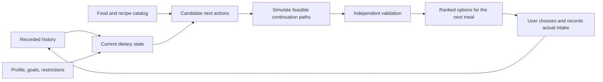
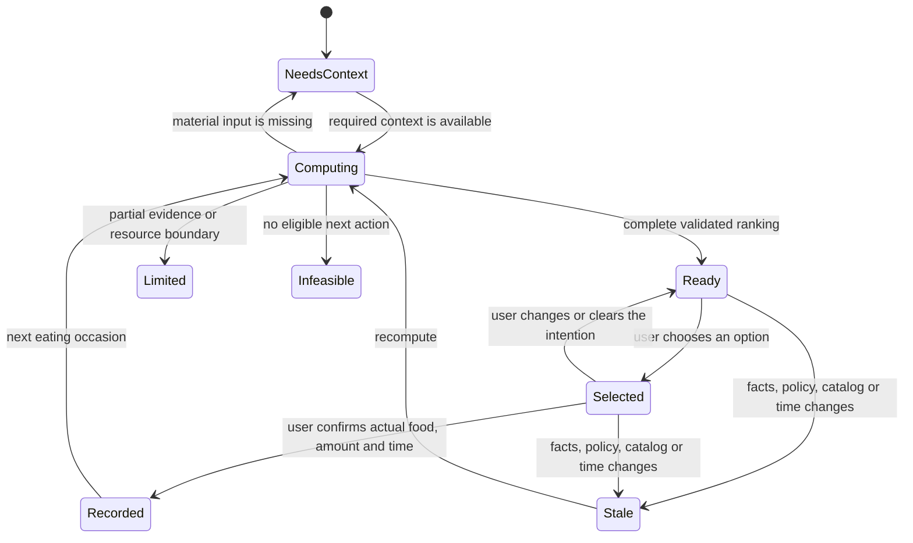

# Next-meal planning: the core Nutrixx decision system

| Field         | Value                                                        |
| ------------- | ------------------------------------------------------------ |
| Status        | Normative target design                                      |
| Audience      | Product, nutrition science, optimization, data, web, quality |
| Owner         | Nutrixx Optimization Engineering                             |
| Last reviewed | 2026-11-07                                                   |

## Product promise

Nutrixx exists to answer one recurring question:

> Given what this person has actually consumed, their current context, the
> evidence available to Nutrixx, and the choices realistically available now,
> what should they eat **next**, and why?

The user receives a ranked set of options for one upcoming eating occasion.
The first option is the best-supported choice under the frozen input and active
policy. Consumption enters the ledger exclusively through explicit user
confirmation of the actual food, amount and time.

The engine looks beyond one meal without publishing a rigid multi-day menu. It
simulates feasible continuation paths over a planning horizon, ranks each
possible next action by the quality of the path it enables, publishes only the
next-meal ranking, and replans after new facts arrive. This is a receding-horizon
decision system.



## What “best” means

“Best” represents the highest-priority feasible next action under an explicit,
versioned decision policy, with the complete objective hierarchy evaluated.

The policy uses lexicographic priorities. Every higher-priority rule reaches its
required state before a lower-priority benefit enters the comparison.

| Priority | Decision objective                                                                    | Treatment                         |
| -------: | ------------------------------------------------------------------------------------- | --------------------------------- |
|        1 | Declared allergies, verified contraindications, hard exclusions and applicable limits | Hard feasibility gate             |
|        2 | Reduce material inadequacy and excess risk across applicable evidence horizons        | Primary optimization objective    |
|        3 | Support energy, macronutrient and dietary-pattern goals without unnecessary overshoot | Strong objective                  |
|        4 | Preserve meal practicality, preference, culture, satiety and expected adherence       | Personalized objective            |
|        5 | Improve variety, cost, preparation effort, inventory use and waste                    | Contextual objective              |
|        6 | Preserve stability when alternatives are materially equivalent                        | Deterministic tie-breaking policy |

The engine reports **best under this policy** as a general-wellness dietary
decision derived from recorded intake evidence.

## Why the engine plans beyond the next meal

A history-only score can identify recorded intake pressure but remains myopic.
It may choose a food that improves the largest immediate gap while making the
remaining energy, upper limits, variety, preferences or practical meal slots
harder to satisfy. A fixed multi-day menu has the opposite problem: it becomes
stale as soon as the user eats something different.

Nutrixx combines both perspectives:

```text
authoritative past intake
+ current state and constraints
+ simulated future continuation
→ next action only
```

The continuation is a decision aid that models plausible future choices. It
answers: “If this is the next meal, can the remaining horizon still be
completed well?” Only the first action is exposed for commitment. The entire
problem is solved again after consumption, correction, time passage, activity
change, profile change or catalog change.

## Evidence model

### Three kinds of truth

| Kind                   | Examples                                                    | Authority in planning                                   |
| ---------------------- | ----------------------------------------------------------- | ------------------------------------------------------- |
| Observed or declared   | Recorded meal, allergy, available ingredient                | Input fact with provenance and uncertainty              |
| Calculated             | Nutrient intake, target distance, energy estimate           | Deterministic domain-engine output                      |
| Predicted or simulated | Adherence likelihood, metabolic response, continuation path | Bounded model output with applicability and uncertainty |

Each kind retains its explicit type and provenance. Predictions retain predicted
status, while food logs represent dietary intake evidence.

### Intake history

Recorded consumption is the intake authority. Suggestions, selected intentions
and unlogged meals contribute no inferred intake. Every recommendation states
that it assumes the user recorded their consumption completely. Missing or
unknown composition remains unknown rather than becoming zero.

Each target is evaluated using its own evidence-backed temporal policy. A
calendar-day reference, a rolling elapsed-time window and a usual-intake model
are distinct. Dietary Reference Intakes generally describe average daily intake
over time; per-meal mapping requires an explicit planning policy. A biological
residence-time claim requires separate evidence before it defines an
intake-comparison rule.

### Dietary state versus physiological state

| Supported dietary inference                                | Measurement-dependent claim                          |
| ---------------------------------------------------------- | ---------------------------------------------------- |
| Recorded intake over a declared window                     | Exact nutrient stores in the body                    |
| Risk that recorded intake is inconsistent with a reference | Clinical deficiency or toxicity                      |
| Trend in energy intake and measured body weight            | A diagnosis or guaranteed causal effect              |
| A validated response prediction with an interval           | Individual response beyond the model's applicability |

Biomarkers, continuous glucose data, weight trends and other measurements may
refine a specifically validated model. They remain separate observations with
their own time, method, applicability and uncertainty.

## Frozen planning context

Every run freezes an immutable, storage-neutral context so that the decision is
reproducible and independently reviewable.

| Context area             | Required content                                                                      |
| ------------------------ | ------------------------------------------------------------------------------------- |
| Identity and eligibility | Subject, population applicability, intended-use boundary and consent                  |
| Profile                  | Age/life stage, relevant physiology, measurements, goals and revision                 |
| Safety                   | Allergies, restrictions, contraindications, medications when supported and evidence   |
| Recorded history         | Accepted meal/correction revisions, quantities, times and composition evidence        |
| Nutrition policy         | Targets, limits, horizons, aggregation, source scope and scientific release           |
| Present context          | Effective time zone, next eating occasion, activity context and hunger when supported |
| Candidate universe       | Exact food/recipe releases, portions, preparation states and provenance               |
| Practical context        | Preferences, culture, budget, preparation time, equipment and optional inventory      |
| Forecast assumptions     | Planning horizon, future meal opportunities and uncertainty scenarios                 |
| Execution policy         | Objective hierarchy, solver configuration, resource limits and deterministic seed     |

Critical missing facts produce a typed refusal or request for input. Noncritical
uncertainty is preserved in the calculation and explanation.

## Planning horizon

The lookback and forecast horizon are different concepts.

| Horizon             | Purpose                                                                 |
| ------------------- | ----------------------------------------------------------------------- |
| Nutrient lookback   | Evaluate recorded intake under each nutrient/reference-specific policy  |
| Behavioral lookback | Estimate preference, repetition, acceptance and routine when supported  |
| Forecast horizon    | Test whether each next action leaves a feasible, good continuation path |
| Publication horizon | Exactly one upcoming eating occasion                                    |

The forecast horizon is policy-driven and may be expressed as meal
opportunities, elapsed time, nutrition days or scenarios. It must be long
enough to expose important downstream trade-offs and short enough to avoid
pretending that distant user behavior is known. Horizon length is validated as
a model parameter rather than treated as a universal nutritional constant.

## Optimization formulation

For each eligible next action `a0`, the engine searches for the best feasible
continuation `a1:H` under the same frozen context:

```text
J(a0) = minimum policy loss across feasible continuations a1:H
rank(a0) = lexicographic order of validated J(a0), uncertainty and tie-breaks
```

The decision variables can include food or recipe identity, portion, meal
opportunity, preparation, inventory use and supported substitution. A
mixed-integer model is the baseline for discrete choices and bounded portions.
Constraint programming or another solver may be used behind an adapter when it
preserves the same domain contract.

### Hard constraints

- declared allergies and immutable user exclusions;
- verified medical or medication rules within supported intended use;
- applicable upper limits and source scopes;
- edible, dimensionally valid and policy-permitted portions;
- availability and ingredient sufficiency when inventory mode is active;
- meal and horizon consistency;
- catalog, recipe, target and policy revision integrity.

An infeasible run reports the relevant conflict. Hard-constraint changes require
an explicit, versioned policy revision.

### Soft objectives

Soft objectives measure distance from preferred states after feasibility is
established. They use normalized, versioned units and explicit priority tiers.
The objective avoids rewarding nutrient overshoot after adequacy unless a
separate evidence-backed goal requires it.

Examples include:

- probability or magnitude of inadequate recorded intake;
- distance from energy and macronutrient ranges;
- dietary-pattern quality and food-group balance;
- food repetition and diversity across the relevant period;
- expected acceptance and adherence;
- portion practicality, cost and preparation burden;
- inventory use, expiry and waste;
- instability relative to a still-valid previous intention.

A single opaque weighted sum is insufficient for safety-critical priorities.
Lexicographic tiers establish precedence; Pareto alternatives may expose
meaningful trade-offs within a tier.

### Terminal value

A terminal value carries dietary continuity beyond the finite forecast
boundary. It estimates whether the final simulated state remains easy to
continue and discourages postponement of difficult goals beyond the horizon.

The active `next-meal-terminal-value-v1` policy appends one internal day to the
three-day decision horizon. Candidate ranking first compares robust decision-
horizon gaps, then the worst terminal maximum and weighted gaps across the same
scenarios. The tail uses the same candidate, hard-limit, schedule and evidence
rules. Tail actions remain simulation evidence: the application publishes only
the first next-meal action and replans after actual intake.

## Uncertainty and robustness

The system tracks uncertainty from portions, composition, recipes, retention
and yield factors, activity estimates, user measurements, target applicability
and predictive models.

| Condition                                             | Required behavior                                       |
| ----------------------------------------------------- | ------------------------------------------------------- |
| Safety-sensitive fact is unresolved                   | Exclude, request input or abstain                       |
| Candidate evidence is materially incomplete           | Classify as evidence-limited                            |
| Several plausible future behaviors exist              | Evaluate declared scenarios or robust bounds            |
| Ranking changes under small plausible input variation | Lower confidence and expose sensitivity                 |
| One option remains strong across scenarios            | Prefer robustness when higher priorities are equivalent |

The active `next-meal-uncertainty-policy-v1` freezes one unperturbed nominal
schedule followed by deterministic stress scenarios of increasing severity.
Each stress case names its perturbation; the current implementation removes a
declared number of future eating opportunities. It preserves every other
frozen fact. Each candidate records exact maximum-gap, weighted-gap and
repetition outcomes per scenario, identifies the nominal and least-favorable
scenario, and derives worst-case objectives from those traces. The independent
validator publishes exclusively aggregates reproduced exactly from the
scenario values.

The engine preserves uncertainty and reports only evidence-supported precision.

## Candidate census and ranking

The active catalog is classified before optimization:

| Classification         | Meaning                                                          |
| ---------------------- | ---------------------------------------------------------------- |
| `COMPARABLE`           | Eligible, supported and sufficiently evidenced for ranking       |
| `EVIDENCE_LIMITED`     | Potentially eligible; material comparison evidence is incomplete |
| `UNAVAILABLE`          | Fails the explicitly selected availability mode                  |
| `EXCLUDED`             | Blocked by a declared or verified hard rule                      |
| `REQUIRES_PREPARATION` | Needs a resolved edible preparation or recipe result             |

Each comparable food or recipe is tested as the first action. The engine finds
its best feasible portion and continuation, independently validates both the
next action and all material score claims, then produces a deterministic total
order. Lower-ranked foods remain valid choices unless their classification
says otherwise.

A `READY` result means the advertised candidate universe was completely
classified and the published order was independently validated. A partial run
publishes coverage-limited status; global-first status requires the complete
advertised census.

## Personalization

Personalization enters only through named, testable channels:

| Channel           | Examples                                                | Control                              |
| ----------------- | ------------------------------------------------------- | ------------------------------------ |
| Requirements      | Life stage, body measurements, applicable target set    | Versioned evidence policy            |
| Safety            | Allergy, restriction, supported clinical rule           | Hard gate                            |
| Behavior          | Preference, routine, rejection, repetition, preparation | User correction and bounded learning |
| Practicality      | Budget, time, equipment, inventory                      | Explicit context                     |
| Measured response | Weight trend, laboratory result, glucose response       | Outcome-specific validated model     |
| Goals             | Maintenance or supported user objective                 | Explicit, revisable intent           |

Machine learning is appropriate for preference, adherence and validated
response predictions. Nutrient requirements originate in versioned evidence
policy, safety rules retain higher authority, and diagnostic claims remain
outside general-wellness scope. Genetics, microbiome and other advanced signals
enter when an outcome-specific model has demonstrated useful validation for the
applicable population.

## User lifecycle



The system distinguishes:

1. **Recommendation:** an immutable calculation result.
2. **Intention:** the user's revisable choice from that result.
3. **Consumption:** the authoritative record of what was actually eaten.

Each record retains distinct semantics, identity and authority.

## Explanation contract

The first screen should answer “what next?” Detailed evidence should answer
“why?” without requiring trust in an opaque score.

Every published run exposes:

- the candidate universe and whether evaluation was complete;
- the assumption that recorded intake is complete;
- the lookback and forecast horizons actually used;
- the decisive hard constraints and exclusions;
- the objectives that materially changed the order;
- recorded, projected and target amounts with units;
- the continuation trade-off that distinguishes close alternatives;
- source, release, uncertainty and missing-evidence status;
- the score definition, interpretation and limits;
- request time, expiry and invalidation reasons.

Every candidate can expose a concise counterfactual:

```text
Why ranked above the next option?
→ better validated improvement in the highest active objective tier
→ while preserving feasible continuation and all hard constraints
```

Generative AI may verbalize this validated trace. Every reason, number and
medical-scope statement originates in typed engine evidence.

## Freshness and replanning

A recommendation becomes stale when any fact capable of changing eligibility,
feasibility or order changes, including:

- a meal is added, corrected or removed;
- time crosses a relevant temporal boundary;
- profile, goal, restriction or time zone changes;
- inventory, food, recipe or portion evidence changes;
- catalog, target, temporal or optimization policy changes;
- a measurement used by an active response model changes;
- the run's validity interval expires.

A stale result remains historical and explainable. Selection is enabled for a
fresh recalculation using the latest accepted facts.

## AI boundary

| AI capability                                              | Authoritative control                                     |
| ---------------------------------------------------------- | --------------------------------------------------------- |
| Parse user language into a typed draft                     | Typed validation publishes accepted user facts            |
| Generate candidate recipes for deterministic evaluation    | Catalog, constraints and independent validation decide    |
| Predict preference or a validated outcome with uncertainty | Versioned evidence policy defines nutrient requirements   |
| Explain a validated decision trace                         | Typed evidence supplies causal and medical-scope language |
| Ask focused questions when material context is missing     | Explicit confirmation resolves safety-sensitive facts     |

The deterministic nutrition, optimization and validation engines retain
authority over every user-visible number and decision claim.

## Determinism, replay and audit

Every run records enough information to reproduce or explain the decision:

```text
run and request identities
frozen context and input hash
catalog, recipe, target and policy releases
lookback and forecast definitions
candidate census and classifications
solver, model, parameters, seed and limits
selected continuation evidence or sufficient replay artifacts
validation report
ranked output and output hash
expiry and invalidation evidence
```

Equivalent frozen inputs and versions produce the same published order. A
faster cache, index, worker count or pagination strategy may change execution
cost while preserving decision semantics.

## Evaluation and release gates

| Dimension           | Required measures                                                               |
| ------------------- | ------------------------------------------------------------------------------- |
| Safety              | Published hard-constraint violations, unsafe abstention failures                |
| Nutritional quality | Target-distance improvement, excess avoidance, dietary-pattern quality          |
| Foresight           | Continuation feasibility, terminal-state quality, myopic-regret against horizon |
| Robustness          | Rank stability under plausible input and forecast uncertainty                   |
| Evidence            | Catalog coverage, unknown composition, provenance and explanation fidelity      |
| Personal relevance  | Acceptance, substitution, correction, repeat use and preference calibration     |
| Practicality        | Cost, preparation burden, inventory feasibility and waste                       |
| Performance         | Latency, peak memory, cancellation, worker responsiveness and device envelope   |
| Reproducibility     | Replay agreement, stable hashes and independent-validator agreement             |
| Fairness            | Coverage and outcome quality across supported population and cultural subgroups |

Golden fixtures cover the obvious best choice, competing deficiencies, upper
limits, sparse evidence, early history, long history, food repetition,
conflicting preferences, unavailable ingredients, recipe yields, stale runs,
time-zone changes, infeasibility and close alternatives. Property tests verify
unit invariants, monotonic safety behavior, deterministic ordering and explicit
preservation of unknown evidence. Adversarial tests target unsafe portions,
source corruption, stale caches, crafted recipes and explanation mismatch.

The decision policy is evaluated offline before release and monitored after
release. Release evidence combines nutritional quality, usability and user
acceptance measures.

## Implementation boundary

This document defines the decision semantics implemented by the active local
engine. `next-meal-hierarchical-robust-v1` evaluates every comparable next
candidate through a deterministic continuation portfolio with:

- a three-day horizon and three modeled eating opportunities per day;
- a one-day terminal tail that protects continuity beyond the decision horizon;
- twelve diverse continuation candidates and up to eight deterministic paths;
- an expected schedule and a scenario with one lost future opportunity;
- lexicographic minimization of horizon gaps, terminal-tail gaps, nominal
  outcome, immediate gap, portion size, repetition and stable identity;
- exact rational arithmetic, independent census validation and replayable
  policy inputs;
- publication of only the next action, followed by complete replanning from
  recorded intake.

The bounded portfolio is the browser-local search strategy, with optimality
claims scoped to its measured search space. A later solver may search a larger
feasible space while preserving this contract. Acceptance evidence reports the
exact policy, catalog, device envelope, latency and memory.

## Related specifications

- [Planning domain model](planning-domain-model.md)
- [Free next-meal recommendation contract](next-meal-contract.md)
- [Optimizer and recommendation engine](optimizer.md)
- [Nutrition foundation and calculation policy](../nutrition-model/foundation.md)
- [Target policy version 1](../nutrition-model/target-policy-v1.md)
- [History-aware next-meal constraints](../decisions/ADR-0016-history-aware-next-meal-constraints.md)
- [Complete local next-meal ranking and replay](../decisions/ADR-0017-complete-local-next-meal-ranking.md)
- [Next-meal lifecycle and personal inventory](../decisions/ADR-0018-next-meal-lifecycle-and-inventory.md)
- [Free next-meal capability boundary](../decisions/ADR-0019-free-next-meal-quality-floor.md)
- [Verification and evaluation](../quality/verification-and-evaluation.md)

## Evidence base

- [U.S. Office of Disease Prevention and Health Promotion: Dietary Reference Intakes](https://odphp.health.gov/our-work/nutrition-physical-activity/dietary-guidelines/dietary-reference-intakes)
- [National Academies: Dietary Reference Intakes—Applications in Dietary Planning](https://nap.nationalacademies.org/catalog/10609/dietary-reference-intakes-applications-in-dietary-planning)
- [NIH Nutrition for Precision Health](https://commonfund.nih.gov/nutritionforprecisionhealth)
- [Food4Me randomized controlled trial](https://pubmed.ncbi.nlm.nih.gov/27524815/)
- [Personalized glycemic-response study](https://pubmed.ncbi.nlm.nih.gov/26590418/)
- [PREDICT 1 postprandial-response study](https://www.nature.com/articles/s41591-020-0934-0)

These references support the nutrition-reference, personalization and
measurable-response foundations. The rolling-horizon architecture is a Nutrixx
engineering decision derived from the product objective and scoped to this
general-wellness system.
