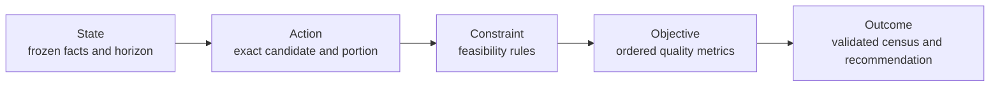

# Planning domain model

| Field         | Value                                                |
| ------------- | ---------------------------------------------------- |
| Status        | Active internal contract                             |
| Audience      | Optimization, nutrition science, web, data, quality  |
| Owner         | Nutrixx Optimization Engineering                     |
| Last reviewed | 2026-11-08                                           |
| Code          | `@nutrixx/optimizer-engine/planning-domain-model-v1` |

## Purpose

Every Planning decision follows one explicit, solver-neutral chain:

The contract separates domain meaning from search strategy. A bounded local
portfolio, a future MILP or CP-SAT solver, and a shadow solver can consume the
same problem and produce outcomes under the same validation rules.

## State

`PlanningStateV1` freezes the facts available at one decision instant.

| Area             | Contract                                                       |
| ---------------- | -------------------------------------------------------------- |
| Identity         | Model version, state key, subject key                          |
| Time             | Capture instant and decision instant                           |
| Policy           | Exact Planning policy version                                  |
| Rolling horizon  | Days, opportunities per day and one published action           |
| Robust scenarios | Stable scenario identity, description and optional probability |
| Facts            | Type, stable key, revision and evidence source                 |
| Completeness     | `COMPLETE` or `LIMITED` with explicit reason codes             |

A State is immutable. New intake, correction, time, inventory, catalog or
policy information produces a new State key and a fresh Planning problem.
When probabilities are declared, every scenario receives one and their exact
total equals one. Expected-value objectives require this complete distribution.

## Action

`PlanningActionV1` represents one exact available decision alternative.

| Field                        | Meaning                                       |
| ---------------------------- | --------------------------------------------- |
| `actionId`                   | Stable identity inside the frozen problem     |
| `stateKey`                   | State that authorizes the action              |
| `candidateKey`               | Exact food or recipe revision                 |
| `portionId` / `edibleGrams`  | Exact evaluated edible portion                |
| `eligibleOpportunityIndexes` | Horizon positions where the action can occur  |
| `evidence`                   | Source supporting candidate and portion facts |

The current publication policy exposes one action for opportunity zero. Future
opportunities remain internal continuation evidence.

## Constraint

`PlanningConstraintV1` determines feasibility.

| Dimension   | Values                                                                           |
| ----------- | -------------------------------------------------------------------------------- |
| Kind        | Safety, eligibility, nutrient limit, inventory, preparation, integrity, schedule |
| Strength    | `HARD` or `SOFT`                                                                 |
| Enforcement | Input validation, candidate classification, horizon search or output validation  |
| Scope       | Global, selected actions or selected scenarios                                   |
| Operation   | Allow, forbid, less-than-or-equal, greater-than-or-equal, equal, known           |
| Bound       | Boolean, exact quantity with unit, or stable reference                           |
| Failure     | Stable reason code for explanation and recovery                                  |
| Authority   | Version and evidence source                                                      |

Hard constraints define the feasible set. Soft constraints provide an explicit
bridge for policies that model a preference as a bounded penalty.

The active `next-meal-hard-constraints-v1` policy covers frozen revision
integrity, complete catalog census, supported intended use, declared
exclusions, restriction evidence, comparable nutrient evidence, edible and
dimensionally valid portions, conditional inventory and recipe sufficiency,
rolling-horizon consistency, and every applicable nutrient upper limit. Each
constraint records the stage that enforces it. Conditional constraints enter
the problem only when their governing mode or evidence is present.

## Objective

`PlanningObjectiveV1` defines an ordered quality metric after feasibility.

| Dimension            | Meaning                                |
| -------------------- | -------------------------------------- |
| Priority tier        | Lexicographic precedence               |
| Order within tier    | Deterministic order inside one tier    |
| Direction            | Minimize or maximize                   |
| Metric               | Stable metric code                     |
| Temporal scope       | Immediate, horizon or terminal         |
| Scenario aggregation | None, nominal, worst case or expected  |
| Weight               | Exact decimal weight                   |
| Activation           | Active or deferred with required facts |
| Authority            | Objective version and evidence source  |

The pair `priorityTier + orderWithinTier` is unique, each tier uses contiguous
zero-based order, and the pairs form a total hierarchy. Solver implementations
preserve that order. Active objectives carry positive weight and exact outcome
values. Deferred objectives carry zero weight, a reason and the fact types that
activate a future validated implementation.

### Active objective hierarchy

| Tier | Policy area                                | Active evaluation                                              | Deferred policy slots                                |
| ---: | ------------------------------------------ | -------------------------------------------------------------- | ---------------------------------------------------- |
|    2 | Nutritional risk                           | Robust maximum and weighted gaps, nominal gaps, immediate gaps | —                                                    |
|    3 | Energy, macronutrients and dietary pattern | —                                                              | Dedicated energy-macro-pattern model                 |
|    4 | Personalization and practicality           | Portion-size tie-break                                         | Expected adherence, culture and satiety fit          |
|    5 | Context                                    | Horizon repetition                                             | Cost, preparation effort, inventory expiry and waste |
|    6 | Stability                                  | Deterministic identity order                                   | Change from a still-valid prior intention            |

This explicit activation model keeps the full product hierarchy visible while
the active ranking uses only validated facts and executable metrics.

## Outcome

`PlanningOutcomeV1` records the validated evaluation of the complete action
census.

| Area                  | Contract                                                                  |
| --------------------- | ------------------------------------------------------------------------- |
| Binding               | Exact problem, state, run and model version                               |
| Run status            | Ready, needs input, infeasible, search limit or failed                    |
| Action classification | Feasible, evidence-limited, unavailable, excluded or preparation-required |
| Constraint trace      | Pass, fail or unknown with reason codes                                   |
| Objective trace       | Exact rational value per objective and optional scenario                  |
| Ranking               | Consecutive total order across feasible actions                           |
| Publication           | First-ranked action from a complete, ready census                         |
| Validation            | Validator version and validation instant                                  |

## Cross-model invariants

`PlanningDecisionChainV1Schema` validates the entire chain together:

1. every action binds to the frozen State;
2. every opportunity fits inside the horizon;
3. every constraint scope references declared actions or scenarios;
4. every objective occupies a unique hierarchy position;
5. every outcome references a declared action, applicable constraint, objective
   and scenario;
6. every feasible action reports every applicable constraint, passes every hard
   constraint and reports each active aggregate objective;
7. outcome values belong exclusively to active objectives;
8. a complete census contains one outcome for every action;
9. feasible ranks form one consecutive order;
10. a `READY` result publishes exactly the first-ranked action.

## Active operational adapter

The optimizer package exports runtime Zod schemas and inferred TypeScript types
for State, Action, Constraint, Objective, Problem, Action Outcome, Outcome and
the complete Decision Chain. Contract tests cover valid construction,
cross-reference integrity, horizon bounds, hard-constraint enforcement,
objective completeness, census completeness and publication authority.

`next-meal-domain-adapter-v1` projects every independently reviewed browser run
into this model before persistence. The mapping is exact and versioned:

| Domain element | Active next-meal mapping                                                                                                        |
| -------------- | ------------------------------------------------------------------------------------------------------------------------------- |
| State          | Subject, request instant, planning policy, horizon scenarios, accepted meal revisions, temporal rules and evidence completeness |
| Action         | The exact best-supported portion selected by the engine for every comparable catalog entry                                      |
| Constraint     | Version integrity, census, intended use, exclusions, evidence, portion, inventory, schedule and nutrient limits                 |
| Objective      | Complete tiers 2–6 with exact active values and explicit deferred slots                                                         |
| Outcome        | Complete feasible action order, first recommendation, validator identity and validation instant                                 |

Catalog entries without an executable portion remain in the upstream complete
classification census and state completeness evidence. A complete census with
zero executable actions produces a typed `NEEDS_INPUT` or `INFEASIBLE`
outcome. The browser stores the model version, adapter version, problem
identity, state identity and canonical Decision Chain hash with the
recommendation run.

## Related specifications

- [Next-meal planning](next-meal-planning.md)
- [Optimizer and recommendation engine](optimizer.md)
- [Free next-meal contract](next-meal-contract.md)
- [Verification and evaluation](../quality/verification-and-evaluation.md)
