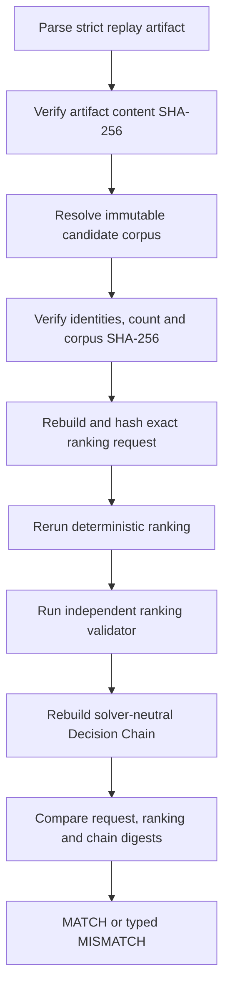

# Planning decision replay

| Field         | Value                                      |
| ------------- | ------------------------------------------ |
| Status        | Active internal contract                   |
| Audience      | Optimization, web, quality, security, data |
| Owner         | Nutrixx Optimization Engineering           |
| Last reviewed | 2026-11-11                                 |
| Code          | `planning-replay-artifact-v1`              |

## Purpose

Every published next-meal decision carries a canonical replay artifact. The
artifact allows Nutrixx to reconstruct the decision from the exact accepted
facts, engine versions and immutable candidate corpus, then compare the new
result with the originally published result without trusting stored output.

Replay answers four different questions:

1. Are the stored artifact bytes internally consistent?
2. Is the resolved food and recipe corpus exactly the corpus used originally?
3. Does the current implementation produce the same complete ranking?
4. Does the solver-neutral Decision Chain remain byte-for-byte equivalent?

## Artifact boundary

`PlanningReplayArtifactV1` is a strict, versioned JSON contract.

| Section           | Frozen evidence                                                                    |
| ----------------- | ---------------------------------------------------------------------------------- |
| Format            | Artifact format, schema version and replay-contract version                        |
| Engine versions   | Domain model, adapter, ranking, constraints, objectives, uncertainty and validator |
| Context           | Problem, run, subject, capture and validation identities                           |
| Request snapshot  | Policy, history, temporal rules, exclusions, inventory, hard limits and units      |
| Candidate corpus  | Ordered content digest, complete keys, release identities and recipe revisions     |
| Expected evidence | Exact request, complete ranking and Decision Chain SHA-256 digests plus State key  |
| Artifact identity | SHA-256 digest of the complete canonical artifact content                          |

The request snapshot retains every dynamic fact that can affect a decision.
The candidate corpus remains an immutable, content-addressed dependency stored
once and referenced by every applicable run.

## Why the candidate corpus is referenced

The catalog contains thousands of foods and up to 112 nutrient facts per food.
Embedding it in every recommendation would duplicate the same large data,
inflate IndexedDB, increase export size and transfer an operational artifact
through browser Worker messages.

The replay artifact instead binds the corpus through all of the following:

- the exact ordered SHA-256 digest of every candidate fact;
- the complete sorted candidate-key manifest;
- the exact catalog release identities;
- every recipe identity and revision;
- the number of candidate records.

The artifact is complete for replay because a resolver must provide content
that satisfies every binding before execution begins. Replay requires an
available corpus and exact corpus agreement; any divergence produces a typed
mismatch.

## Deterministic replay sequence

The replay implementation treats the recalculated ranking as authoritative. It
independently reviews that ranking and recreates the full State → Action →
Constraint → Objective → Outcome chain.

## Outcomes

| Status     | Meaning                                                                |
| ---------- | ---------------------------------------------------------------------- |
| `MATCH`    | Artifact, corpus, request, ranking, validator and Decision Chain agree |
| `MISMATCH` | At least one typed integrity or reproducibility invariant diverges     |

Stable mismatch reason codes distinguish artifact corruption, corpus identity,
corpus content, request, ranking, validator and Decision Chain failures. A
consumer reports all independently observable mismatches, preserves the
evidence and requires a fresh authoritative decision before publication.

## Persistence and performance

Each artifact is stored once as an immutable canonical
`planning.next-meal-replay` record. The active `planning.next-meal-run` stores
its artifact identity, and runtime hydration resolves that reference after both
canonical records pass integrity checks. The disposable display cache and UI
Worker messages omit the artifact. This preserves audit evidence without
increasing rendering memory, pagination payloads or routine interaction cost.

Only one active next-meal run is retained by the current local workflow.
Historical replay records remain available after replanning, so every published
decision can be reconstructed. Each artifact references the already-installed
immutable catalog corpus and stores its dynamic evidence once.

The same atomic publication stores a separate
`planning.next-meal-shadow-comparison` record. Replay proves reproducibility;
shadow mode compares independently constructed decision paths. Their primary
Decision Chain digests must agree before the active run can be loaded.

## Integrity and authenticity

Canonical JSON plus SHA-256 detects accidental corruption and establishes
content identity. Creator authenticity requires a digital signature. A future
server-backed audit channel may sign an artifact digest or anchor it in an
append-only service while preserving replay semantics.

## Acceptance rules

A replay implementation passes only when it demonstrates all of the following:

- identical frozen evidence produces identical request, ranking and chain
  digests;
- changing one nutrient fact while retaining the same food identity fails the
  corpus-content check;
- changing an artifact field without updating its content digest fails before
  the stored expected result is trusted;
- the active contract accepts the exact declared policy and engine versions;
- the independent validator approves the recalculated result;
- the UI projection and display cache contain no replay artifact payload.

## Related specifications

- [Planning domain model](planning-domain-model.md)
- [Next-meal planning](next-meal-planning.md)
- [Optimizer and recommendation engine](optimizer.md)
- [Verification and evaluation](../quality/verification-and-evaluation.md)
