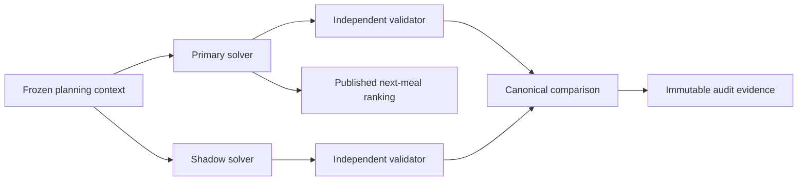

# Planning shadow mode

| Field         | Value                                      |
| ------------- | ------------------------------------------ |
| Status        | Active independent MILP shadow             |
| Audience      | Optimization, web, quality, data, security |
| Owner         | Nutrixx Optimization Engineering           |
| Last reviewed | 2026-11-12                                 |
| Code          | `planning-shadow-comparison-v1`            |

## Purpose

Shadow mode evaluates a second decision path against every published next-meal
decision. The primary solver retains exclusive publication authority. The
shadow path produces immutable comparison evidence for engineering review,
release qualification, and future solver evolution.



## Active v1 shadow

The active `next-meal-highs-milp-shadow-v1` runs the lockfile-pinned highs-js
1.15.4 adapter and its HiGHS engine locally through WebAssembly inside the
disposable planning Web Worker. Each execution records the embedded engine
version. The adapter consumes the solver-neutral Decision Chain and performs
four deterministic steps:

1. validate the frozen state, action set, constraints and objective traces;
2. reconstruct the exact lexicographic order with rational arithmetic;
3. compile that order into a binary mixed-integer model with one variable per
   feasible action and an exactly-one selection constraint;
4. require an optimal HiGHS solution and validate the resulting shadow chain.

The browser loads the pinned HiGHS WebAssembly asset from the same origin. The
asset participates in normal application build preparation and keeps planning
data on the user's device.

The MILP shadow provides independent search evidence for:

- state identity;
- outcome status;
- feasible action-set identity;
- top recommendation identity;
- exact hierarchy and complete rank order;
- top-k overlap;
- per-action rank deltas;
- solver optimality, model identity and engine identity.

The current model independently solves action selection over canonical
objective traces produced by the solver-neutral domain contract. A future
coefficient adapter can independently recreate the full multi-day horizon model
and continue using the same comparison and publication boundary.

## Mathematical model

For each active objective in priority order, the adapter derives ordinal
coefficients from exact rational values, creates binary variables `x_i`, and
solves one MILP stage:

```text
minimize   sum(objective_rank[s, i] * x_i)
subject to sum(x_i) = 1
           every earlier stage remains at its optimum
           x_i in {0, 1}
```

The adapter locks each stage optimum before advancing and closes the hierarchy
with the canonical action-identity tie-break. Ordinal coefficients preserve
exact per-objective ordering while avoiding floating-point approximation of
domain scores. HiGHS must return `Optimal`, a single selected action and the
hierarchy's first action. Every run records the combined model SHA-256, model
and solver versions, HiGHS version, variable and final constraint counts,
selected action, objective value and zero optimality gap.

## Comparison outcomes

| Outcome                     | Meaning                                              | Severity |
| --------------------------- | ---------------------------------------------------- | -------- |
| `MATCH`                     | State, feasibility, recommendation and order agree   | None     |
| `ORDER_DIVERGENCE`          | Feasible actions agree and at least one rank differs | Review   |
| `RECOMMENDATION_DIVERGENCE` | The published top action differs                     | Critical |
| `FEASIBILITY_DIVERGENCE`    | Outcome status or feasible action set differs        | Critical |
| `INPUT_DIVERGENCE`          | Solvers evaluated different frozen state identities  | Critical |

Every report states `publicationAuthority: PRIMARY_ONLY` and
`shadowAffectsPublication: false`. These literals make the authority boundary
machine-verifiable.

## Persistence and integrity

Each comparison and its MILP execution evidence are stored as an immutable canonical
`planning.next-meal-shadow-comparison` record in the same atomic publication
transaction as the run, replay artifact, and feedback trial. The active run
stores a compact summary and comparison identity. Loading the run verifies:

1. every canonical record digest;
2. subject, run, problem and state identity;
3. the primary Decision Chain SHA-256 against replay evidence;
4. the compact summary against the full comparison record;
5. the primary-only publication literals.

Historical comparison records remain available after replanning. The
disposable display cache carries the compact summary and omits the full report.

## Operational use

| Signal                    | Engineering response                                       |
| ------------------------- | ---------------------------------------------------------- |
| Match                     | Preserve evidence and continue normal publication          |
| Order divergence          | Review comparator, precision, tie-breaks and version drift |
| Recommendation divergence | Hold the candidate release for engineering review          |
| Feasibility divergence    | Review constraints, evidence census and solver mapping     |
| Input divergence          | Review snapshot construction and adapter identity          |

The product surface presents the comparison outcome and agreement status while
keeping solver internals in the immutable audit record.

## Acceptance rules

- equivalent exact traces produce byte-stable `MATCH` evidence;
- changing rank order produces deterministic rank deltas;
- changing the top action produces critical recommendation divergence;
- every chain passes the independent decision validator before comparison;
- HiGHS returns an optimal binary solution with one selected action;
- every report carries the engine version and model SHA-256;
- comparison evidence participates in atomic publication;
- a shadow result has zero influence on the user-facing ranking;
- another solver adapter can reuse the comparison API and report schema.

## Related specifications

- [Planning domain model](planning-domain-model.md)
- [Planning decision replay](planning-replay.md)
- [Planning validation](planning-validation.md)
- [Next-meal planning](next-meal-planning.md)
- [Verification and evaluation](../quality/verification-and-evaluation.md)
